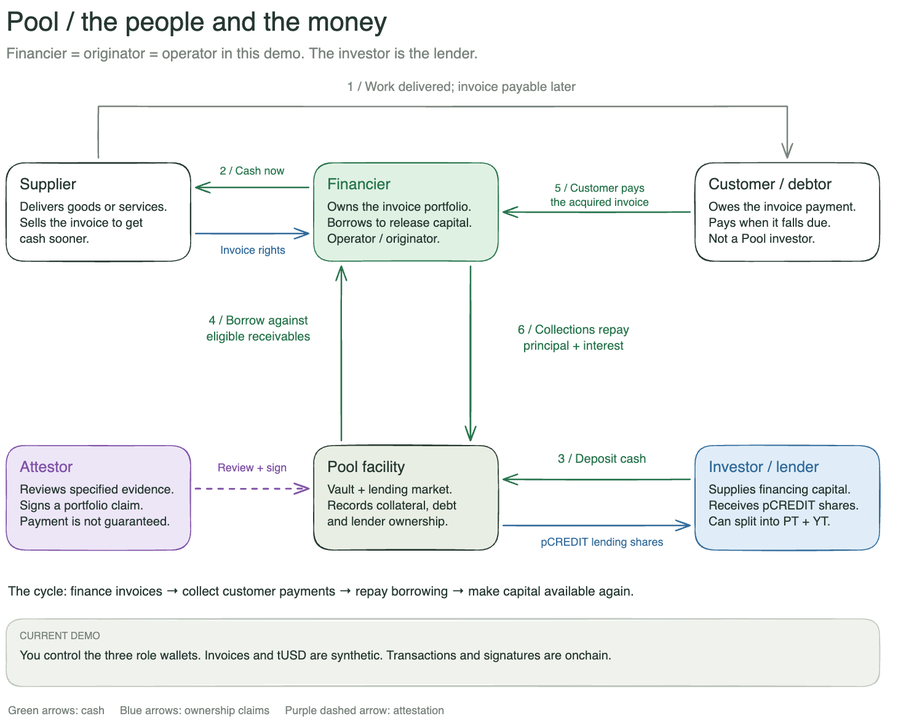
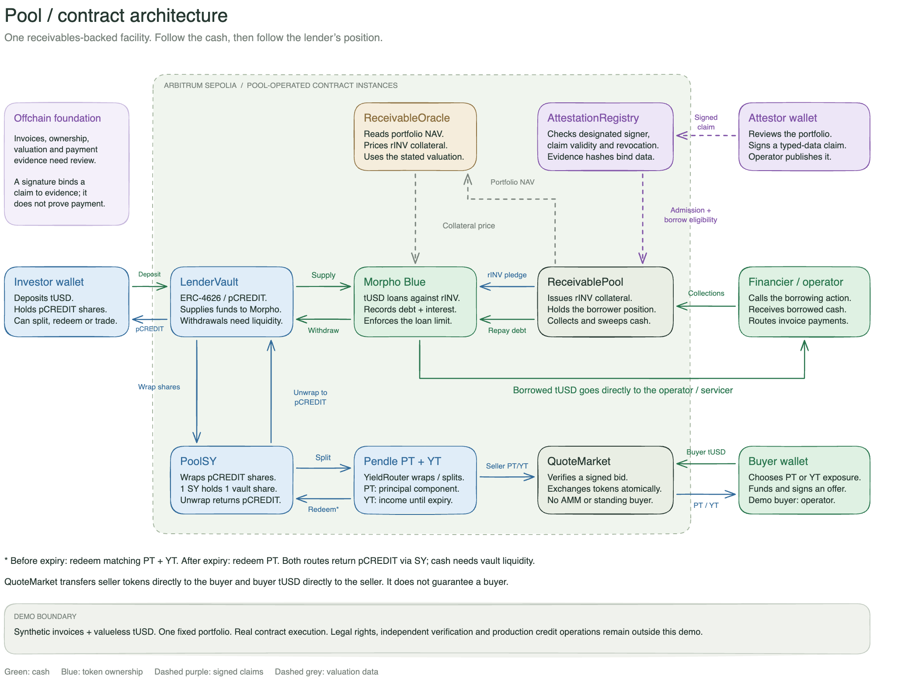

# Pool

**Trade credit, composed.** Finance a receivables portfolio. Separate the lender's principal from its future income. Bring collections back into repayment.

A supplier finishes a job today and gets paid sixty days later. A financier can pay the supplier early and acquire the invoice — but now the financier's capital is waiting for that payment. Repeat this across a portfolio, and the ability to finance the next supplier depends on how quickly capital comes back.

Pool connects that cycle to programmable lending. The financier pledges an existing receivables portfolio, lenders supply capital, and the financier borrows against it. A lender can keep the whole lending position or split it into **principal and future yield**, with each component held or traded separately.

The idea we are exploring is an **attested credit position with separately transferable principal and income**. Morpho provides lending; Pendle provides the split. Pool connects the evidence, collateral, servicing and investor workflow around them. The composition is our product thesis. We do not claim to have invented invoice financing or yield tokenisation.

**[Open the public demo](https://pool-omega-five.vercel.app)** · **[Follow the demo script](docs/DEMO_SCRIPT.md)** · **[Download the complete Excalidraw canvas](docs/diagrams/pool-complete-overview.excalidraw)**

> **Arbitrum Sepolia testnet · chain ID 421614.** Invoices and tUSD are synthetic. Contract transactions, signature verification and token transfers execute onchain. Pool operates its own deployments of Morpho and Pendle's contracts; these are not official protocol listings or connections to their existing liquidity.

## The people and the money



We use five business roles to explain the flow. The public demo represents them with three controlled wallets and synthetic offchain activity.

| Role                                  | What they do                                                                      | How it appears in this demo                                                                                                                      |
| ------------------------------------- | --------------------------------------------------------------------------------- | ------------------------------------------------------------------------------------------------------------------------------------------------ |
| **Supplier**                          | Delivers goods or services and sells an invoice to receive cash sooner.           | The acquisition has already happened in the fixture; no live supplier onboarding.                                                                |
| **Financier / originator / operator** | Owns the portfolio, pledges it, borrows working capital and services collections. | One operator wallet controls the facility. These three names refer to the same participant here.                                                 |
| **Investor / lender**                 | Supplies financing capital and receives lending-vault shares.                     | Can deposit, withdraw, split shares and trade PT/YT.                                                                                             |
| **Attestor**                          | Reviews specified evidence and signs a portfolio claim.                           | A designated wallet signs a commitment published in the registry. A signature identifies a claim; it does not independently establish its truth. |
| **Customer / debtor**                 | Owes the invoice payment.                                                         | Collections are simulated by an operator-funded tUSD transfer. No bank payment feed is connected.                                                |

A **secondary buyer** can purchase PT or YT from the investor. Any funded wallet can take this role, including the attestor wallet. In our recording plan, we reuse the attestor wallet as buyer (one wallet, two distinct actions). All roles remain controlled by us; the trade demonstrates settlement, not independent demand.

The cycle is straightforward: **finance invoices → collect customer payments → repay borrowing → make capital available again**. The current release demonstrates one facility. A self-service workflow for institutions to create their own facilities is still future work.

## Follow one position: tUSD → pCREDIT → PT + YT

Think of **pCREDIT** as units in the lending fund. The investor contributes cash and receives units recording their share of the fund's assets.

| Token          | What it represents                                                            | How it is created or received                                                                                            |
| -------------- | ----------------------------------------------------------------------------- | ------------------------------------------------------------------------------------------------------------------------ |
| **tUSD**       | Pool Test Dollar, used for loans, deposits and settlement. No monetary value. | Minted during setup, claimed through the test faucet, or transferred by another wallet. It is not USDG, USDC or TrueUSD. |
| **rINV**       | The receivables-pool collateral token.                                        | Issued through portfolio admission and pledged by the facility into Morpho. It belongs on the borrower side of the flow. |
| **pCREDIT**    | The investor's proportional interest in the ERC-4626 lending vault.           | The vault mints shares to the investor when they deposit tUSD. The vault supplies that cash into Morpho.                 |
| **SY-pCREDIT** | Pendle-compatible backing for the lending shares.                             | Pool's SY wrapper holds one pCREDIT for each SY share issued.                                                            |
| **PT**         | The principal component of a split position.                                  | Pendle's contracts mint PT to the investor when they split their shares.                                                 |
| **YT**         | The income entitlement of that position until expiry.                         | Minted alongside PT to the same investor. It can then be sold or transferred separately.                                 |

Suppose we deposit **25,000 tUSD** when one pCREDIT represents one tUSD. The vault issues approximately **25,000 pCREDIT**. If we split 5,000 shares, those shares leave our wallet and move into SY backing. Pendle receives that backing and issues PT and YT to us; the exact token amount depends on the index at execution.

We still hold the unsplit shares. We also hold both components of the split position. If we sell 1,000 YT, the buyer owns that income entitlement, while our PT stays with us. The original pCREDIT remains in the wrapper. **The same position has been separated; its value has not been doubled.**

Before expiry, matching PT and YT can be recombined. After expiry, PT can be redeemed without YT. Our router returns **pCREDIT shares**; withdrawing those shares for tUSD is a separate step and requires available lending liquidity.

### What makes these tokens worth something?

For pCREDIT, the useful starting point is the vault's accounting:

```text
pCREDIT redemption value ≈ vault assets / outstanding pCREDIT shares
```

Borrower interest increases lender assets, so the same share count can represent more tUSD. Recognised Morpho bad debt can reduce that value. New deposits issue corresponding shares; they do not themselves make existing holders richer. Collateral impairment and lender loss are distinct events: writing down portfolio NAV does not immediately write down the lender vault; loss reaches the vault when bad debt is realised in Morpho.

Interest accrual is an accounting claim, not necessarily cash ready to withdraw. Both matter. The UI shows share value and available withdrawal capacity separately.

PT and YT have contract-defined entitlements, but **buyers and sellers set their trading prices**. PT pricing reflects time to maturity, required return, credit risk and liquidity. YT pricing reflects expected income over the remaining term, along with risk and liquidity. Once the term ends, YT earns no further yield; previously accrued interest may still be claimable.

Our marketplace uses signed bids with an explicit token amount and total tUSD payment. It does not calculate a fair price or run a Pendle AMM. A demo offer of **1 tUSD for 1,000 YT** is a chosen test quote. The contract checks the signature, expiry, permissions and funding, then settles both transfers atomically.

PT is **not capital protected**, and YT is not a first-loss tranche. Splitting changes who holds which entitlement; it does not remove the underlying credit risk. See [Pendle's tokenisation mechanics](https://docs.pendle.finance/pendle-v2/ProtocolMechanics/YieldTokenization/PT) and our [accounting and production assumptions](docs/PRODUCTION_GAPS.md).

## What actually runs



The architecture drawing uses the operator as an example secondary buyer. The rehearsal below uses the attestor wallet instead; either funded wallet follows the same purchase path.

| Component                     | Implementation                                                                                                                 |
| ----------------------------- | ------------------------------------------------------------------------------------------------------------------------------ |
| **Lending and liquidation**   | Unmodified Morpho Blue **1.0.0** source, compiled with Solidity **0.8.19**, deployed by Pool.                                  |
| **Principal/yield mechanics** | Pendle core-v2 **6.11.0** factory and PT/YT contracts, deployed by Pool with the factory proxy.                                |
| **Portfolio and evidence**    | Custom `ReceivablePool`, `AttestationRegistry` and servicer-controlled book-NAV oracle.                                        |
| **Investor position**         | Custom ERC-4626 `LenderVault`, `PoolSY` adapter and atomic `YieldRouter`.                                                      |
| **Secondary settlement**      | Custom `QuoteMarket`: signed, fixed-size bids paid in tUSD. No AMM or guaranteed buyer.                                        |
| **Rate model**                | Fixed **12% borrowing APR** for the demo, rather than Morpho's AdaptiveCurveIRM. Lender yield depends on utilisation.          |
| **Cash**                      | Six-decimal `TestDollar` with a test faucet. No issuer-backed stablecoin integration.                                          |
| **Public interface**          | React, TypeScript and Vite; reads contract state and requests transactions through the connected wallet.                       |
| **Local development**         | Disposable Anvil chain and a loopback-only API controlling local demo roles. This API is not the public app's signing service. |

The market uses **tUSD as loan currency, rINV as collateral and 62.5% LLTV**. That threshold describes borrowing relative to oracle-valued collateral, not the percentage of lender funds being used. At 250,000 borrowed from 400,000 supplied, utilisation also happens to be 62.5% — a separate calculation. With the demo rate model, the indicative lender APR is then about 7.5%, before the stated simplifications.

Collateral and loan tokens both use six decimals. The oracle returns `NAV × 10^36 / collateralSupply`. SY's exchange rate is `vault.convertToAssets(10^18)`; each SY share wraps one pCREDIT share. The code keeps collateral ownership and lender ownership separate throughout.

### Open the diagrams in Excalidraw

Download the [complete canvas](docs/diagrams/pool-complete-overview.excalidraw), open [Excalidraw](https://excalidraw.com), and load the file through **Menu → Open**. Press **Shift + 1** to fit the canvas. The participant flow is on the left and the contract architecture is on the right; every element remains editable.

Individual files are available too:

- **Participant flow:** [Excalidraw](docs/diagrams/pool-participants-flow.excalidraw) · [PNG](docs/diagrams/pool-participants-flow.png) · [SVG](docs/diagrams/pool-participants-flow.svg).
- **Contract architecture:** [Excalidraw](docs/diagrams/pool-contract-architecture.excalidraw) · [PNG](docs/diagrams/pool-contract-architecture.png) · [SVG](docs/diagrams/pool-contract-architecture.svg).

## Public testnet release

The initial deployment, attestation publication, portfolio admission and activation are complete. Setup supplied **375,000 tUSD** of initial lending liquidity. That is a setup amount, not a claim about today's balance: deposits, trades and repayments persist on the public chain.

The interface now has a shared sticky navigation across **Home, Invest, Portfolio, Market, Proof and About**, with operator controls available from the same shell. Disconnected visitors can inspect the facility and evidence. Personal holdings are shown for the connected wallet rather than staged investor balances. The homepage includes the launch film; the About page explains the problem and mechanism.

- [Public deployment manifest](public/deployment.json): addresses, code hashes, signed evidence and setup receipts.
- [Published attestation transaction](https://sepolia.arbiscan.io/tx/0x829d065b31555d85ff28f6328635485d6c6aa3b2cd47834cce5f69b759c3437e).
- [Source verification report](docs/source-verification.json): Sourcify results, separate from Arbiscan verification badges and security audits.
- [Recorded release status](docs/release-status.json): a dated snapshot of deployment and verification work; its balances and remaining steps may predate later wallet actions.

The public application holds no signing keys or privileged transaction API. Attestations bind the pool, evidence commitment, currency, values, validity and nonce. Duplicate or unapproved admission is rejected. Expired or revoked eligibility stops new borrowing while preserving repayment.

### Wallets and test currency

| Demo role                  | Address                                      |
| -------------------------- | -------------------------------------------- |
| Operator / financier       | `0xEb3356a0b57e7dcCb9341fD40545a5dCb6239267` |
| Investor / lender          | `0x68C6e946d815E9df17548f822379ADD9D9439530` |
| Attestor / secondary buyer | `0x45b16B03CA58Ac4E02e1522c8457F2BfEe4F8790` |

Use **Arbitrum Sepolia**, with test ETH for gas. To display the currency in MetaMask, import this custom token on that network:

```text
Contract: 0x0c62a607fd0146b10f35011e3d0636a6b541186a
Symbol:   tUSD
Decimals: 6
```

Importing a token displays its balance; it does not fund the account. The app's faucet allows a wallet to claim **10,000 tUSD once per day**. A transfer of 5,000 tUSD from investor to buyer only moves wallet cash: it does not change vault deposits, collateral, PT/YT or the attestation. Keep enough investor cash for the planned deposit.

Judges can connect their own wallet, claim test dollars and try a smaller deposit and split. Borrowing and servicing require the operator; trading requires a funded counterparty.

## Walk through the public demo

Use the [speak-along script](docs/DEMO_SCRIPT.md) for exact field labels, expected results and narration. Enter amounts in **Pool's forms** and review the resulting approvals and transactions in MetaMask. Reconnect in Pool after changing wallet accounts.

| Step | Wallet                    | Action                                                                        | What we show                                                                       |
| ---- | ------------------------- | ----------------------------------------------------------------------------- | ---------------------------------------------------------------------------------- |
| 1    | Any                       | Inspect **Portfolio**, then **Proof → Evidence**.                             | The synthetic assets, claim, signer and public evidence.                           |
| 2    | Investor                  | **Invest → Overview:** deposit **25,000 tUSD**.                               | Cash becomes pCREDIT; lending supply increases.                                    |
| 3    | Operator                  | **Servicing → Additional facility controls:** borrow **250,000 tUSD**.        | The financier draws working capital; borrower interest becomes the yield source.   |
| 4    | Investor                  | **Invest → Yield lab:** split **5,000 pCREDIT**.                              | Shares move into backing; the investor receives both PT and YT.                    |
| 5    | Attestor, acting as buyer | **Market:** bid **1 tUSD total for 1,000 YT**, naming the investor as seller. | A funded wallet signs an explicit purchase offer.                                  |
| 6    | Investor                  | Review and fill that bid.                                                     | YT moves to the buyer, tUSD moves to the investor, and PT stays with the investor. |
| 7    | Operator                  | Record **1,000 tUSD** collected on **SG-001**, then **Sweep into repayment**. | Collection cash enters the portfolio and reduces its configured debt.              |
| 8    | Any                       | **Proof → Activity:** refresh public event history and open a receipt.        | The outcome is inspectable onchain.                                                |

These are rehearsal inputs, not instructions to repeat completed transactions. **Additional draw adds debt**; it does not set a target balance. Check the existing position before borrowing again. The bid lasts one hour, so recreate an expired offer before recording.

Optionally, before expiry, recombine **500 PT + 500 YT** into pCREDIT and make a small withdrawal. For a real maturity demonstration, prepare the separate short-expiry series using the [testnet runbook](docs/TESTNET_RUNBOOK.md). Public time must actually pass; the local demo's time controls do not exist on Arbitrum Sepolia.

Real-time interest will move slowly during a short recording. Show the exchange rate and claimable interest at the displayed precision. Keep impairment, liquidation and revocation for a separate recording or the end of the healthy flow.

## Run it locally

Requires **Node.js 22.12+** and Foundry's **Anvil** on your PATH. Once dependencies are installed, the disposable local stack needs no external RPC, wallet, database or paid API.

```sh
npm ci
npm run dev
```

Open **http://127.0.0.1:5173**. This compiles contracts, starts Anvil, deploys and seeds the protocol instances, starts the local API and serves the frontend. Ports **8545**, **8787** and **5173** must be free.

The local fixture starts with 485,000 tUSD of book NAV, 400,000 supplied and 250,000 borrowed. It is deliberately pre-seeded for exercising interest, collections, impairment, liquidation and expiry. Those values are not the current public deployment's balances.

Reloading the browser preserves positions. Restarting the local stack creates a fresh disposable chain. Deployment data lives in the Git-ignored `.runtime/` directory. Stop with Ctrl+C.

To run the wallet-connected frontend against the public manifest instead:

```sh
npm run dev:testnet   # http://localhost:5174
npm run build:release # compile, export browser artifacts and build the frontend
```

Use [TESTNET_RUNBOOK.md](docs/TESTNET_RUNBOOK.md) for deployment recovery, signatures, source verification and manifest publishing. An existing facility does not need to be redeployed for a frontend change.

## Verification and scope

```sh
npm run check                 # compile, protocol tests, typecheck and build
npm run test:browser          # requires the local demo running, with an unexpired series
npm run test:browser:testnet  # requires the frontend on 5174; uses an isolated test chain/wallet
```

Browser tooling uses agent-browser and Playwright. If a browser is missing, run `npx agent-browser install`. Lifecycle tests change disposable state; restart the local demo before a clean presentation.

Protocol coverage includes accounting, access controls, liquidity-limited withdrawal, borrowing, actual Morpho liquidation and bad debt, Pendle mint/claim/redemption, collection repayment and closure. Browser reports distinguish local lifecycle checks, the public wallet adapter on an isolated chain, and read-only public RPC checks. None establishes that an unrecorded transaction occurred in the public release.

See [verification notes](docs/verification.md), [local browser evidence](docs/browser-verification.json), [wallet-flow evidence](docs/testnet-browser-verification.json) and [public-read evidence](docs/public-browser-verification.json). These are dated reports, not a fresh test run for every README edit. Tests and source verification do not constitute a security audit.

The current boundary is explicit: synthetic invoices, operator-entered collections, a controlled oracle, a fixed demo rate and Pool-operated protocol deployments. InvoiceNow, TradeTrust, TFR, banks, SPVs and asset registries are not connected. Singapore provides the use-case context; it does not imply affiliation or access to those systems.

Offchain title, enforceability, underwriting, duplicate-pledge prevention and independent servicing remain work for a real deployment. Book NAV is not a buyer's executable bid. The liquidation backstop is finite. Maturity does not force an invoice payment or create withdrawal liquidity. Pendle's expiry index uses its first post-expiry update rather than backdating to the exact maturity second.

The detailed assumptions are in [PRODUCTION_GAPS.md](docs/PRODUCTION_GAPS.md). Keep Anvil and the local operator API private and use test keys only.

## Repository map

- `contracts/Pool.sol`: test currency, receivables collateral, oracle, rate model, lender vault and SY adapter.
- `contracts/AttestationRegistry.sol`: designated-attestor claims and revocations.
- `contracts/YieldRouter.sol`: atomic Pendle splitting and redemption.
- `contracts/QuoteMarket.sol`: signed PT/YT bids and atomic payment settlement.
- `src/`: shared navigation, investor workflow, operator tools, About page and wallet integration.
- `src/lib/deployment.mjs`: resumable wallet-driven setup.
- `public/deployment.json`: the shared public facility manifest.
- `public/film/`: launch-film and hero-cut assets.
- `scripts/compile.mjs`: pinned Solidity compilers and unmodified upstream sources.
- `scripts/chain.mjs`, `scripts/server.mjs`, `scripts/dev.mjs`: disposable local-chain orchestration and API.
- `tests/`: protocol, deployment, attestation, market and supporting regression tests.
- `docs/diagrams/`: editable Excalidraw sources plus PNG/SVG previews.
- `docs/DEMO_SCRIPT.md`: screen-by-screen rehearsal and narration.

Upstream licenses apply to their source. Custom Solidity files declare GPL-3.0-or-later; review the upstream licenses before redistributing a deployment or source bundle.

## To-do

Unchecked demo items mean **verify and capture the outcome**, not automatically rerun a transaction that may already be complete.

### Finish the hackathon demonstration

- [ ] Reconcile current public balances and completed steps with the demo script; update the dated release-status report with receipt evidence.
- [ ] Capture the public investor deposit, financier borrowing and PT/YT split with the correct connected wallets.
- [ ] Fund the secondary buyer and capture a signed YT bid plus its successful paid settlement; show that the investor retains PT.
- [ ] Capture an invoice collection, debt repayment and the corresponding public receipts.
- [ ] Record early recombination and a liquidity-backed withdrawal; optionally prepare a short-expiry series for actual maturity redemption.
- [ ] Check the final hosted app in a fresh disconnected browser and complete the judge path with a fresh wallet.
- [ ] Record the walkthrough, include the participant diagram, and submit the public URL, repository, manifest, receipts and video within the event's format limits.

### Extend the product after this demo

- [ ] Build an institution workflow to configure, attest and publish separate facilities, with explicit validation and roles.
- [ ] Choose and validate the intended stablecoin and target protocol deployments; add test USDG only if a supported issuer/network deployment is available.
- [ ] Add bid discovery and clearer quote context; evaluate an AMM only alongside a credible plan for funded liquidity.
- [ ] Improve portfolio updates, maturity/renewal workflows, RPC resilience and transaction indexing.
- [ ] Establish asset ownership, underwriting, payment reconciliation and independent attestation with actual counterparties before introducing real receivables.
- [ ] Review loss handling, transfer restrictions, collateral liquidation and liquidity under adverse scenarios; complete invariant/fuzz testing and independent security review before real capital.
