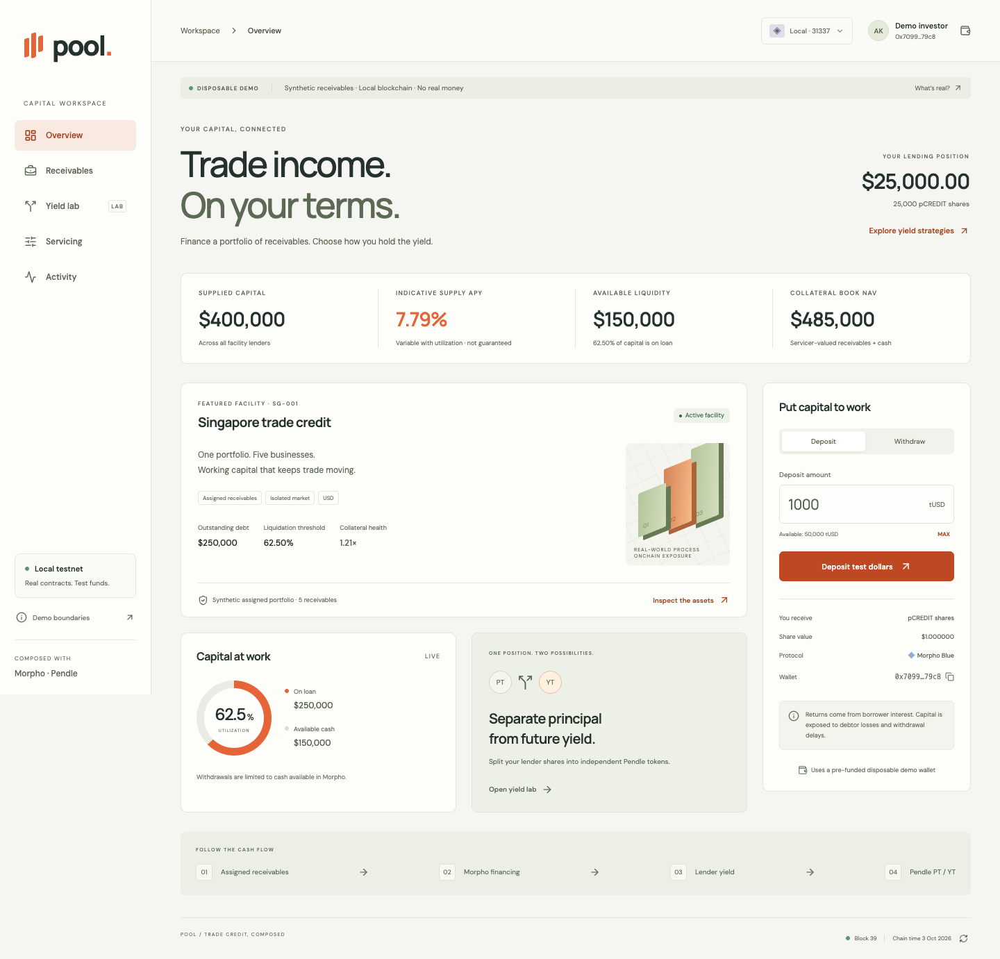

# Pool

**Trade credit, composed.** An Arbitrum Sepolia showcase of attested receivables-backed borrowing, Morpho lending, and Pendle principal/yield separation.



## Public testnet release

**Live application:** https://pool-omega-five.vercel.app — view the pool without a wallet.

The contracts are deployed on Arbitrum Sepolia (421614). The attestor's signed portfolio has been published and admitted, the pool is activated, and 375,000 tUSD of initial lending liquidity was supplied. The investor received 75,000 tUSD; its deposit and the operator's borrowing remain separate wallet actions for the public rehearsal.

- [Public deployment manifest](public/deployment.json): addresses, code hashes, signed evidence and 25 confirmed setup transactions.
- [Attestation publication](https://sepolia.arbiscan.io/tx/0x829d065b31555d85ff28f6328635485d6c6aa3b2cd47834cce5f69b759c3437e).
- [Source verification results](docs/source-verification.json): Sourcify verification, separate from Arbiscan badges.
- [Release status](docs/release-status.json): completed checks and remaining submission work.

Use [TESTNET_RUNBOOK.md](docs/TESTNET_RUNBOOK.md) for wallet deployment, signing, source verification, publishing the shared manifest and recording the video. [TESTNET_RELEASE.md](docs/TESTNET_RELEASE.md) records the release scope. The original local demo instructions below remain available for accelerated scenarios.

```sh
npm run build:release  # reproducible compile, browser artifacts and public frontend
npm run dev:testnet   # wallet-connected frontend on port 5174
```

The public application holds no signing keys or privileged transaction API. Attestations bind the pool, evidence commitment, currency, values, validity and nonce. The pool rejects unapproved or duplicate admission; expired/revoked eligibility stops borrowing while preserving repayment. Signed bids settle actual test-dollar payments atomically. All external receivables remain synthetic.

## Run the local demo

Requires Node.js 22.12+ and Foundry's `anvil` on your PATH. No wallet, private key, external RPC, database or paid API is required.

```sh
npm ci
npm run dev
```

Open **http://127.0.0.1:5173**. The command compiles the contracts, starts Anvil, deploys and seeds the protocols, starts the local API, and opens the Vite server. Ports **8545**, **8787** and **5173** must be free.

Browser reloads preserve onchain positions. **Restarting the stack creates a fresh disposable chain** and resets the demo. Stop with Ctrl+C. Deployment addresses and transaction receipts are written to `.runtime/` and excluded from Git.

## What works

- Deposit and withdraw test dollars through an ERC-4626 vault into an actual Morpho Blue market.
- Borrow against a synthetic assigned-receivables portfolio, repay, and enforce the collateral threshold.
- Wrap lender shares in a custom SY adapter and mint **actual Pendle PT and YT** using Pendle's factory.
- Transfer YT independently, claim interest, unwrap SY, and redeem matching PT/YT before expiry or PT alone after expiry.
- Record collections as actual token transfers. Remove the corresponding receivable book value to avoid counting assets twice.
- Sweep cash only into the facility's debt; recognize impairment; exercise a finitely funded liquidator through Morpho.
- Close a debt-free facility and redeem residual collateral subject to collected cash.
- Inspect evidence fixtures, live contract balances, actor addresses and confirmed transaction hashes. Export a state snapshot.

This implementation uses a **funding facility**: the originator already owns the receivables and pledges them to borrow working capital. Investors own lender vault shares, whose yield comes from **Morpho borrower interest**. The receivables collateral (`rINV`) and lender shares (`pCREDIT`) are separate claims. This is not a direct invoice-purchase vault, and Pendle does not split invoice discount income directly.

The working sprint scope is recorded in [SPRINT_SPEC.md](docs/SPRINT_SPEC.md). The public extension is recorded in [TESTNET_RELEASE.md](docs/TESTNET_RELEASE.md).

## Five-minute local demo

1. **Overview:** inspect $485,000 of initial book NAV, $400,000 supplied, and $250,000 borrowed. The investor starts with $25,000 of lender shares and $50,000 of test cash. Deposit $1,000.
2. **Yield lab:** split 5,000 shares into PT and YT. The original shares move into SY backing; they are not duplicated.
3. **Servicing:** advance the chain by 30 days. Return to Yield lab, claim the accrued interest as SY, then unwrap it into lender shares.
4. **Yield lab:** transfer 100 YT to the separate demo trader. PT remains with the investor. This is a transfer, not a sale.
5. **Servicing:** collect $10,000 on SG-001, then sweep the cash into repayment. Check that receivable book value and debt both change.
6. **Servicing:** set SG-001 and SG-002 book values to zero. The position becomes liquidatable. Acquire 100,000 rINV from the backstop account; it spends actual test cash and receives collateral.
7. **Servicing:** advance another 100 days. In Yield lab, redeem PT without YT into vault shares. A later stablecoin withdrawal remains liquidity-limited.

To demonstrate complete credit failure, the protocol test also writes down all assets, seizes all remaining collateral and verifies that Morpho's bad debt reduces the vault exchange rate and PT redemption value.

## Verification

```sh
npm run check        # compile both Solidity versions, run protocol tests, typecheck and build
npm run test:browser # with the local stack running and an unexpired Pendle series
```

The browser test uses `agent-browser` and Playwright. Install the browser with `npx agent-browser install` if the first launch reports that no browser is available. It changes the disposable demo state; restart `npm run dev` afterwards for a clean presentation.

Protocol tests cover accounting, access control, available-liquidity limits, genuine liquidation, Pendle mint/claim/redemption, bad-debt losses and facility closure. Browser verification covers the UI → API → chain → refreshed UI lifecycle at desktop and mobile widths. See [browser-verification.json](docs/browser-verification.json) for the latest run and [verification.md](docs/verification.md) for boundaries of that evidence.

## Architecture

```text
Already-owned synthetic receivables
                 │
        ReceivablePool / rINV ─── book-NAV oracle
                 │ collateral
                 ▼
           Morpho Blue ─────── tUSD borrowing → originator
                 ▲
                 │ supplied liquidity
Investor tUSD → LenderVault / pCREDIT
                            │
                          PoolSY
                            │ Pendle core factory + atomic router
                        PT     YT
```

| Component                | Implementation                                                        |
| ------------------------ | --------------------------------------------------------------------- |
| Lending and liquidation  | Unmodified Morpho Blue 1.0.0 source, compiled with Solidity 0.8.19    |
| PT/YT and factory        | Pendle core-v2 6.11.0 source, locally deployed with its factory proxy |
| Rate model               | **Demo-only** fixed 12% borrowing APR; not AdaptiveCurveIRM           |
| Collateral and valuation | Custom synthetic pool and servicer-controlled book-NAV oracle         |
| Vault and SY             | Custom ERC-4626 lender vault, 1:1 share wrapper, atomic Pendle router |
| Cash                     | 6-decimal `tUSD`; no relation to issuer-backed USDG or USDC           |
| Interface                | React, TypeScript, Vite; state is read from contracts                 |
| Operator API             | Loopback-only Node HTTP server; serialized allowlisted actions        |

Both token families use six decimals. The collateral oracle returns `NAV × 10^36 / collateralSupply`, matching Morpho's scaling when both assets use six decimals. The SY exchange rate is `vault.convertToAssets(10^18)` and redemption returns **vault shares**.

## Explicit limits

**This is an Arbitrum Sepolia testnet showcase with an optional disposable local demo.** Morpho and Pendle instances are deployed and operated by Pool from pinned upstream sources, not official protocol deployments or listings. The public app includes signed, fixed-size PT/YT bids that settle only when funded; it has no secondary AMM or guaranteed liquidity. No real-money assets are accepted.

Every buyer, invoice, assignment, valuation and payment input is synthetic. Evidence hashes commit to exact synthetic documents; designated-attestor signatures identify claims without independently proving those documents true. InvoiceNow, TradeTrust, TFR, banks, SPVs and registries are not connected. The interface's Singapore framing does not imply affiliations or access to those systems.

PT is **not capital protected**. YT is not a first-loss tranche. Book NAV is not a liquidation bid. The backstop is finite, not insurance. Pendle maturity does not force debtor payment or make borrowed cash instantly available. Standard Pendle accounting snapshots the index at its first post-expiry update; it does not backdate the lending vault's exchange rate to the precise maturity second.

See [PRODUCTION_GAPS.md](docs/PRODUCTION_GAPS.md) before designing a real deployment. Do not expose the local operator API or Anvil to the public internet, add real keys to this demo, or interpret tests as a security audit.

## Repository guide

- `contracts/Pool.sol`: receivables, oracle, test currency, demo IRM, lender vault and SY.
- `contracts/YieldRouter.sol`: atomic tokenization and redemption through actual Pendle.
- `scripts/compile.mjs`: separate pinned compilers; upstream sources are not patched.
- `scripts/chain.mjs`: deployments, fixture funding, block-consistent reads and allowlisted actions.
- `scripts/server.mjs`, `scripts/dev.mjs`: local API and process orchestration.
- `src/`: responsive application and onchain state types.
- `tests/protocol.test.mjs`: integration tests against a separate Anvil node on port 18545.
- `scripts/verify-browser.mjs`: repeatable browser lifecycle regression.

Upstream contract licenses apply to their source. The custom Solidity files declare GPL-3.0-or-later. Review all upstream licenses before redistributing a deployment or source bundle.
